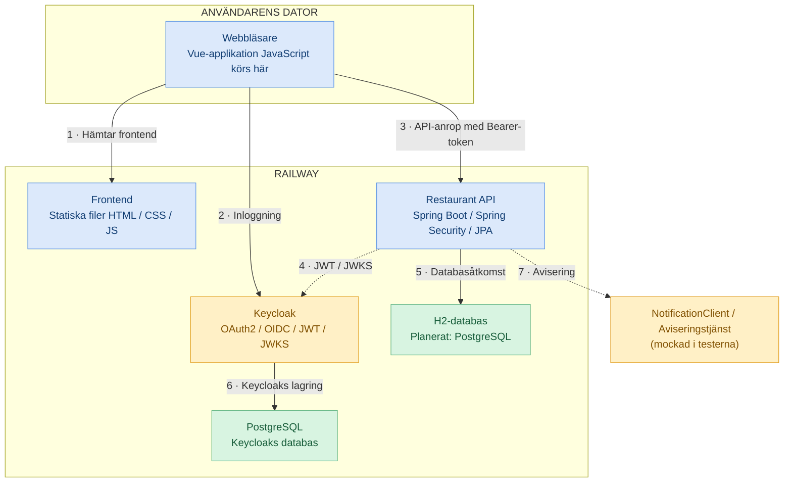
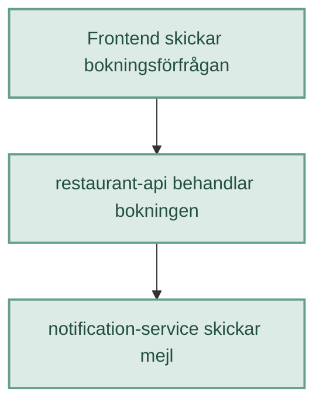

# Del 4: Teknikreflektion

## Fråga 1: CSRF och CORS

Du fattade två beslut i del 3. Du konfigurerade CORS för en origin och valde att antingen stänga av eller behålla CSRF-skyddet.

Förklara båda besluten. Vad skyddar CORS mot, vad skyddar CSRF mot och varför är det inte samma sak? Beskriv konkret vad som hade kunnat hända i just din bokningstjänst om du hade fattat fel beslut om CSRF.

**Räcker för G:** du håller isär de två sakerna och motiverar ditt CSRF-beslut korrekt utifrån din arkitektur.

**Bygger på:** kapitel 10 och 11. Du kan besvara den här frågan redan nu.

-------------------------------------------------------------------------------------------------

Svar

**CORS → vilka origins får anropa API:t från webbläsaren?**

**CSRF → kan någon förfalska en autentiserad request?**

CORS: Cross-Origin Resource Sharing, när ett javascript I en websida med ett visst origin, anropar ett API med en annan origin och ändå får lov att läsa svaret.

Same Origin Policy är browserns grundregel, dvs den som anropar måste ha samma origin som tjänsten/API:t som anropas. Min Vue/Rewact-frontend som körs i Railway med origin [**https://restaurant-frontend.up.railway.app**](https://restaurant-frontend.up.railway.app/) anropar mitt backend REST-API med en annan origin [**https://restaurant-api.up.railway.app**](https://restaurant-api.up.railway.app/)**. **Detta skulle normalt blockas, eftersom Same Origin Policy är browserns grundregel, men jag har har konfigurerat Spring Security att göra ett undantag och tillåta frontend att läsa svaret, dvs 1. API:t svarar med *Access-*Control-Allow-Origin:* *[**https://restaurant-frontend.up.railway.app**](https://restaurant-frontend.up.railway.app/)*,*2. browsern jämför med javascriptets origin, 3. Eftersom de är exakt samma skickas svaret vidare till FE-javascriptet. **

CSRF: Cross Site Request Forgery.

CSRF-skydd handlar om förhindra otillåtna state-changing requests att nå ett API. Men eftersom mitt API kräver Bearer token (*Authorization: Bearer \<token\>*) för att en request ska accepteras och webläsaren inte automatiskt lägger till en sådan på en request från en annan webbplats, **kan en angripare normalt inte få webläsaren att skicka en sådan **request. Slutsats: jag kan stänga av CSRF-skyddet genom att lägga till detta I min spring security config: .csrf(AbstractHttpConfigurer::disable) **

**OM jag inte hade stängt av CSRF hade Spring security krävt en CSRF-token för alla state-changing requests (POST, **PUT**, **PATCH, **DELETE) **i** tillägg till bearer jwt/token. Men eftersom det inte finns någon sådan skulle svaret bli 403 **på alla såna requests vilket INTE skulle vara bra.**.**

## Fråga 2: SOAP och WSDL

Ditt API är byggt med REST. Beskriv vad SOAP är och vad ett WSDL-dokument innehåller.

Föreställ dig sedan att bokningstjänsten ska integreras med ett hotellkedjesystem från 2009 som bara kommunicerar via SOAP. Vad hade du behövt göra annorlunda och vad hade WSDL-filen gett dig som du inte får från din OpenAPI-specifikation?

**Räcker för G:** du beskriver envelope, body och fault samt förklarar vad WSDL beskriver och vad det används till.

**Bygger på:** kapitel 17 och 18, vecka 39.

--------------------------------------------------------------------------------------------

Svar

SOAP är ett protokoll för att utbyta strukturerad information mellan olika system baserat på XML. Transporten sker med HTTP. Det används ofta inom verksamheter såsom bank, försäkring, offentlig sektor.

Det består av Envelope som omsluter meddelande och bl a anger vilken SOAP-version som används, Header som är optional och kan ange information som mottagaren behöver för att behandla meddelandet, t ex om den måste kvittera.

Body är obligatorsk och innehåller ärendet som mottagaren ska utföra eller svaret på förfrågan. Det som meddelandet handlar om helt enkelt. Om SOAP-anropet misslyckas innehåller bodyn istället ett SOAP-Fault som säger vad som gick fel.

XSD:n är en fil som beskriver hur XML-meddelandet får se ut.

WSDL är ett XML-baserat kontrakt som beskriver en SOAP-tjänst. Det talar om för en klient vilka operationer tjänsten erbjuder, vilken information kleinten måste skicka, vilket svar klienten kan förvänta sig, hur kommunikationen ska gå till och vilken adress tjänsten finns på. Det uppfyller ungefär samma funktion som OpenAPI gör för REST.

## Fråga 3: Driftsättning

I del 3 driftsatte du din tjänst någonstans.

Vilka tre alternativ vägde du mot varandra innan du fattade ditt beslut? Vad kostade de, vad krävde de av dig och vad avgjorde ditt val? Beskriv också hur ditt val hade påverkats om tjänsten plötsligt fått tusen samtidiga användare.

**Räcker för G:** tre alternativ är namngivna och jämförda utifrån åtminstone pris och driftsansvar, och ditt val är motiverat.

**Lyfter till VG:** du har faktiskt valt bort ett alternativ av ett skäl som är relevant för din tjänst, inte bara av vana. Du kan förklara vad valet kan kosta dig senare och vad som skulle få dig att byta.

**Bygger på:** kapitel 25 och 26, vecka 41.

--------------------------------------------------------------------------------------

**Svar:**

Tre alternativ jag väler emellan:

|                             |                                                     |                                               |           |     |
|-----------------------------|-----------------------------------------------------|-----------------------------------------------|-----------|-----|
| Alternativ                  | Kostnad                                             | Driftsansvar                                  | Kallstart |     |
| SaaS/Railway                | Trafik/resursbaserad kostnad. Låg vid låg trafik    | Mkt lite                                      | Nej       |     |
| VPS/Hetzner                 | Fast månadskostnad, kostar även om den inte används | Jag ansvarar för drift, t ex OS-uppdateringar | Nej       |     |
| Serverless/Google Cloud Run | Kostnad baserat på antal anrop och exekveringstid   | Nej                                           | Ja        |     |

Mina förutsättningar:

|                  |                               |
|------------------|-------------------------------|
| Beslutsfaktor    | Mitt Restaurant API           |
| Trafikmängd      | Låg                           |
| Trafikmönster    | Relativt kontinuerligt        |
| Krav på svarstid | Kallstarter är inte önskvärda |
| Driftkompetens   | Liten                         |
| Databas          | PostgreSQL                    |
| Autentisering    | Keycloak                      |

Beslut:

Jag låter Railway hantera infrastrukturen och driftsätter varje del som en separat tjänst.

- Restaurant API körs som en Java-process i en container.
- Keycloak körs i en egen container.
- PostgreSQL körs som en databastjänst med permanent lagring.
- Railway hanterar HTTPS, domäner, driftsättning och omstarter.

Railway har även dokumenterade lösningar för Keycloak tillsammans med PostgreSQL.

**Fördelar:** Relativt enkelt, liten arbetsinsats för drift, bra GitHub-integration och lätt att uppdatera applikationen. Ingen kallstart. Betalar bara för trafiken

**Nackdelar:** löpande kostnader för tjänster som behöver vara igång kontinuerligt. Kostnader ökar med ökad trafik.

**Vad skulle få mig att byta: **Om kostnaderna ökar betydligt eller om vi får tekniska krav som Railway inte uppfyller.

## Fråga 4: End to end

Rita kedjan från gästen till databasen: webbläsaren eller klienten, ditt API, aviseringstjänsten som du mockade i del 2 och databasen. Det räcker med en enkel skiss i text eller bild.

Gäst → webläsare/client → inlogg från Keycloak →

Svara sedan på följande frågor: Var brister kedjan först? Vad märker gästen när det händer? Vad hade du behövt mäta för att upptäcka problemet innan gästen ringer?

**Räcker för G:** kedjan är komplett, du pekar ut en svag punkt och beskriver vad användaren ser.

**Lyfter till VG:** du resonerar om vad som händer när aviseringstjänsten är långsam men fortfarande fungerar, och hur det påverkar svarstiden för din egen tjänst. Du föreslår något konkret att mäta, inte bara ”loggning”.

**Bygger på:** kapitel 27 och 28, vecka 41. Kedjan kan du rita redan efter del 2.

----------------------------------------------------------------

Svar:

Hela kedjan, inkl keyCloak:

Specifik kedjan fråntend – Backend – Avisering

**Exempel: En kund gör en bokning**

*En Trace – flera Spans*

Ett tänkbart fel är att aviseringstjänsten inte svarar när BookingService försöker skicka en bokningsbekräftelse. Bokningen kan redan vara sparad i databasen, men aviseringen misslyckas.

Gästen kan då få besked om att bokningen lyckades men inte få något bekräftelsemejl.

Och om aviseringstjänsten svarar långsamt eller felet inte hanteras kan gästen även uppleva lång svarstid eller få ett felmeddelande.

Jag skulle använda RED-mätvärden för att övervaka antalet anrop (Rate), fel (Errors) och svarstider (Duration). Jag skulle också mäta misslyckade aviseringar.

Med ett gemensamt Trace ID skulle jag kunna följa en bokningsförfrågan genom API och dess beroenden för att se var problemet uppstår.

## Fråga 5: Spring Cloud

Din bokningstjänst består av en enda applikation. Anta att den delas upp i tre applikationer: en för restauranger, en för bokningar och en för aviseringar.

Vilka nya problem uppstår så snart du gör uppdelningen? Vilka av dem löser Spring Cloud åt dig, och hur? Nämn minst två komponenter vid namn och förklara vad de gör.

**Räcker för G:** du beskriver två konkreta problem som uppstår vid uppdelningen och kopplar dem till rätt Spring Cloud-komponenter.

**Bygger på:** kapitel 23 och 24, vecka 40.

--------------------------------------------------------------------------

Svar:

Svar: som microservices måste komponenterna prata med varandra och de behöver hålla reda på url:er för att göra det. Spring cloud erbjuder eureka service registry och service discovery. Eureka registrerar alla tjänster och varje registrerad tjänst skickar regelbundet ett livstecken, ett så kallat heartbeat. Om en tjänst slutar skicka heartbeat kommer den efter en specifik tid avregistreras.

Registrerade tjänster kan hitta varandra genom att Spring injicerar en färdig DiscoveryClient (interface). DiscoveryClient kan mha .*getInstances() hitta instanser av en viss tjänst*

|                           |                                                                 |
|---------------------------|-----------------------------------------------------------------|
| Komponent                 | Ansvar                                                          |
| Eureka                    | Håller reda på vilka tjänster och instanser som är registrerade |
| DiscoveryClient           | Ger Java-koden tillgång till informationen om instanser         |
| Spring Cloud LoadBalancer | Väljer vilken instans som ska ta emot ett HTTP-anrop            |

## Beslut:
### Del 1: Del 1: REST-API
Paginering på /restaurants. Jag väljer Offset pagination eftersom risken för pageDrift inte är så stor 
(inte frekvent att restauranger läggs till) och att antal restauranger förväntas bli begränsade. 
Det är enkelt att implementera.

## Del 2: Tester och mockning
Jag har använt mig av Mockito i både BookoingService-test och BookingApiIntegrationTest. Eftersom jag inte har någon 
NotificationClient implementerad behöver jag inte "mocka" en sådan eller dess HTTP-anrop mot extern tjänst.
Jag behöver bara en ersättning för clienten som returnerar positivt eller negativt beroende på om nofifiering skickades eller inte.
WireMock testar mer av den riktiga HTTP-integrationen.

Principiell skillnad:
Mockito: LoanService → Mock NotificationClient → STOPP
WireMock: LoanService → NotificationClient → riktig HttpNotificationClient → riktig JSON/HTTP → WireMock

### Del 3: Säkerhet och drift
CSRF: fatta ett beslut och skriv en kommentar i koden om varför det är rätt beslut för just din tjänst. 
CORS ska vara konfigurerat för din frontends origin. Du ska inte använda wildcard tillsammans med credentials, och du ska veta varför.